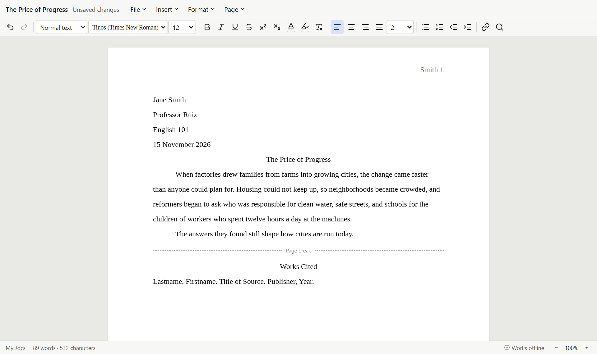

# MyDocs

A free, source-available word processor for high school and college students. It runs entirely on your device: no account, no sign-in, no tracking, and your files never leave your computer. It covers everything a school paper needs, MLA and APA included, and nothing else.



## What it does

- **Write and format.** Fonts that match Times New Roman, Arial and Calibri, sizes, bold, italic, underline, strikethrough, superscript, subscript, color, highlight. Title and three heading levels, bulleted and numbered lists, block quotes, alignment, line spacing (1, 1.15, 1.5, 2), space before and after, indents, first-line and hanging indents.
- **Tables, images, links.** Insert tables, add and remove rows and columns, merge cells, header rows. Insert images from a file, by pasting or by dragging; resize and align them. Links to web pages and email addresses.
- **School paper templates.** File > New from template sets up an MLA paper or an APA student paper: heading or title page, running header with your last name and page number, double spacing, and a Works Cited or References page.
- **Page setup and printing.** Letter or A4, margins, header, footer, and page numbers, including MLA's "Smith 3". Print, or save as PDF from the print window.
- **Word files.** Open a .docx (it opens as a copy; the original is never changed) and save as a Word file to hand in or share. Exports are checked in Google Docs and LibreOffice.
- **Dark mode and a typewriter light.** View > Dark for a dark app and a dark page (it still prints black on white), or Match my device. View > Typewriter light puts a small LED just under the word you're typing, its light fanning up over the word and the lines above while the rest of the page sits in shadow, like writing by a lamp at night.
- **Tools.** Undo and redo, find and replace, word and character count, your browser's spell check, zoom, and the usual keyboard shortcuts (Ctrl+B, Ctrl+S, Ctrl+P and so on).
- **Never lose work.** Everything you type is backed up on your device within a second. If the browser or computer crashes, MyDocs offers your work back the next time it opens.
- **Works offline.** After the first visit, the whole app runs with no internet. In Chrome or Edge you can install it as an app with its own window.

## Using it

MyDocs is a web app: **[open MyDocs](https://mswayney-software.github.io/MyDocs/)** in Chrome, Edge, Firefox or Safari. After the first visit it works offline, and in Chrome or Edge you can install it as an app (the Install button in the top bar).

- **Saving.** In Chrome and Edge, Ctrl+S saves back to the file you opened. Firefox and Safari can't write to files on your computer, so Ctrl+S downloads a copy instead, and the app tells you so.
- **Files.** Documents are saved as `.owdoc` files, a single file with everything in it, images included. Use File > Save as Word file for a `.docx`.
- **Printing headers and page numbers.** Chrome and Edge (version 131 or newer) print headers, footers and page numbers. Firefox and Safari print the right paper size and margins but can't print headers or page numbers yet; the app warns before printing. For MLA and APA papers, print from Chrome or Edge, or save as a Word file.

## MySlides: help test it

MySlides is the second app on this foundation: a presentation app for school, offline like MyDocs. It is on the `myslides-phase0` branch ([draft PR #1](https://github.com/mswayney-software/MyDocs/pull/1)), not on `main` yet. It is built through Phase 7 of 8 (Phase 8, polish, is next). The automated tests (about 140 unit and 110 browser tests in Chrome and Firefox) pass. What's below is what they can't cover: real devices, real print windows, real projectors, and how it feels.

**Try it:** [open the MySlides preview](https://raw.githack.com/mswayney-software/MyDocs/c5a0b8fdbe8dd3ce07e12bdc15b0d8b09b4b5da0/index.html) (tap through the "Open the page" screen; the preview needs the internet). For the big tests, download the [stress deck](https://github.com/mswayney-software/MyDocs/raw/c5a0b8fdbe8dd3ce07e12bdc15b0d8b09b4b5da0/stress-deck.myslides) (60 slides, 30 pictures, 10 tables, 10 charts, 5.4 MB) and open it with File > Open.

**Report what you find** as a [GitHub issue](https://github.com/mswayney-software/MyDocs/issues): the browser and its version, the computer or phone, the steps, what you expected and what happened, and a screenshot or the PDF if there is one. One issue per problem.

### Needs a person (highest value first)

1. **Save as PDF in Firefox.** Open the stress deck, File > Save as PDF…, follow the note (Save as PDF, Landscape, headers and footers off). Check: 60 pages, one slide per page, no slide cut off at any edge, text can be selected in the PDF. Note the page size from the PDF's document properties.
2. **Save as PDF in Safari, on a Mac and on an iPhone or iPad.** Same steps. Phase 0 found Safari prints on Letter portrait and cut the slide off; the app now scales each slide to the page, so check nothing is cut off and nothing is blank.
3. **Save as PDF in Chrome and Edge, through the real print window.** Should be 60 pages exactly 13.333 × 7.5 inches, edge to edge, no blank pages. Zoom the PDF to 400% on a chart and a table: lines should stay sharp.
4. **Presenter view with a real second screen or projector** (Chrome, Edge and Firefox). Present menu (the arrow beside Present) > Presenter view. Drag the audience window to the projector, press F there. Check: arrow keys and clicks in either window move both; B blanks the screen; the timer, clock, next slide and notes on your screen; closing either window ends the presentation and the editor comes back with nothing changed.
5. **Present with the network off.** Open the app once online (so it caches itself), then turn Wi-Fi off and present the stress deck start to finish: nothing should change, every picture should show.
6. **A low-end laptop (4 GB of memory, built-in graphics)**, the computer the speed targets are set for. With the stress deck:
   - it opens in under 3 seconds;
   - typing in a text box has no visible lag;
   - dragging a shape or picture stays smooth;
   - clicking between slides in the strip feels instant;
   - the Slide sorter (status bar) scrolls smoothly top to bottom;
   - while presenting, the next slide appears without a pause;
   - the browser's task manager (Shift+Esc in Chrome) shows the tab under 500 MB.

   Also insert a phone photo (Picture button): it should be on the slide in under 2 seconds.
7. **Screen readers** (NVDA or Narrator on Windows, VoiceOver on Mac or iPhone). Move around with the keyboard only: the slide strip (arrow keys, Ctrl+arrows to reorder), the canvas (Tab between items, arrows move them, Enter edits text), the chart data window, a table, and Present. Is everything announced, and can everything be reached?
8. **Install as an app** (Chrome or Edge: the Install button in the top bar). Then double-click a `.myslides` file in your file manager: it should open in the installed app.
9. **Tablets and narrow windows.** The app should be usable down to 768 pixels wide (an iPad in portrait).
10. **The Phase 0 print test page** in Firefox and Mac Safari: `print-test.html` in the [preview](https://raw.githack.com/mswayney-software/MyDocs/c5a0b8fdbe8dd3ce07e12bdc15b0d8b09b4b5da0/print-test.html), Save as PDF with default settings, and note the page count and page size.

### General use

Build a real deck for a class: a title slide, some text slides, a photo, a table, a bar, line and pie chart, speaker notes, a theme, transitions. Save it, close the tab, reopen it. Present it. Save it as a PDF. Anything confusing, slow, ugly or broken is worth an issue, including the wording.

### Known gaps (no need to report)

- Phase 8 (polish) hasn't started: the accessibility, performance and offline passes, empty states, error messages, and the first-run deck.
- Only the File menu exists; Insert, Format, Arrange and Slide are toolbar buttons for now.
- Elements and table columns can't be resized with the keyboard yet (moving with arrows works).
- A table's thumbnail updates when you leave the table, not while you type.
- The name "MySlides" and the `.myslides` extension are placeholders.
- The preview link above shows the build as of Phase 7; a new link comes with each update.

To run MySlides locally instead: `npm install`, then `npm run dev -w myslides`. `npm run stress-deck -w myslides` writes the stress deck to `apps/slides/stress-deck.myslides`. What's been checked so far, phase by phase, is in [docs/REUSE_AUDIT.md](docs/REUSE_AUDIT.md).

## Privacy

MyDocs has no server. It makes no network requests after it loads: no analytics, no fonts or images from the web, no accounts. The app's content security policy blocks any request to another site, so this is enforced by the browser, not just promised. Your documents and their backups stay on your device. Details in [SECURITY.md](SECURITY.md).

## Develop

Requires Node.js 24.

```sh
npm install
npx playwright install chromium firefox
npm run dev -w mydocs        # local dev server
npm run build -w mydocs      # production build in apps/docs/dist/
npm run preview -w mydocs    # serve the production build (with offline support)
BASE_PATH=/MyDocs/ npm run build -w mydocs  # build for a subfolder, as GitHub Pages serves it
npm test           # unit tests (Vitest), every app
npm run test:e2e   # browser tests (Playwright, Chromium and Firefox), accessibility scan, typing speed
npm run lint       # oxlint
npm run typecheck  # tsc
npm run licenses   # check dependency licenses, regenerate THIRD_PARTY_LICENSES.md
cd apps/docs && node scripts/fetch-sample-papers.mjs  # real school papers for the Word import tests (optional)
```

The repository holds MyDocs in `apps/docs`, code shared between apps in `packages/core`, and a second app in progress in `apps/slides`.

The Word import tests also run against ten real sample papers from university writing centers, listed with their sources in `apps/docs/e2e/fixtures/sample-papers.json`. They belong to their schools, so they are not in this repository; the fetch script downloads them, and the tests skip any that are missing. Set `EXPORT_OUT=<folder>` when running `apps/docs/e2e/docx.spec.ts` to keep every exported .docx for a look in Word, Google Docs or LibreOffice.

See [docs/ARCHITECTURE.md](docs/ARCHITECTURE.md) for how the code fits together, [docs/FILE_FORMAT.md](docs/FILE_FORMAT.md) for the `.owdoc` format, [docs/ROADMAP.md](docs/ROADMAP.md) for what's next, and [CONTRIBUTING.md](CONTRIBUTING.md) to help.

## Built with

[Tiptap](https://tiptap.dev) (MIT core only) on [ProseMirror](https://prosemirror.net), React, Vite and TypeScript. [docx](https://github.com/dolanmiu/docx) writes Word files and [mammoth](https://github.com/mwilliamson/mammoth.js) reads them. [browser-fs-access](https://github.com/GoogleChromeLabs/browser-fs-access), [idb-keyval](https://github.com/jakearchibald/idb-keyval), [vite-plugin-pwa](https://vite-pwa-org.netlify.app), [Lucide](https://lucide.dev) icons, and the Tinos, Arimo and Carlito fonts via [Fontsource](https://fontsource.org).

## License

[PolyForm Noncommercial 1.0.0](LICENSE): free to use, study, change and share for noncommercial purposes, including personal study and use by schools, charities and government bodies. Commercial use needs separate permission. Versions up to and including 1.1.0 were released under the MIT License, and copies of those keep it.

Third-party licenses are listed in [THIRD_PARTY_LICENSES.md](THIRD_PARTY_LICENSES.md). Allowed dependency licenses: MIT, BSD, Apache-2.0, ISC, SIL OFL, and Zlib (for pako, used by JSZip). One test-only exception: axe-core (MPL-2.0), the accessibility scanner, which never ships in the app.
